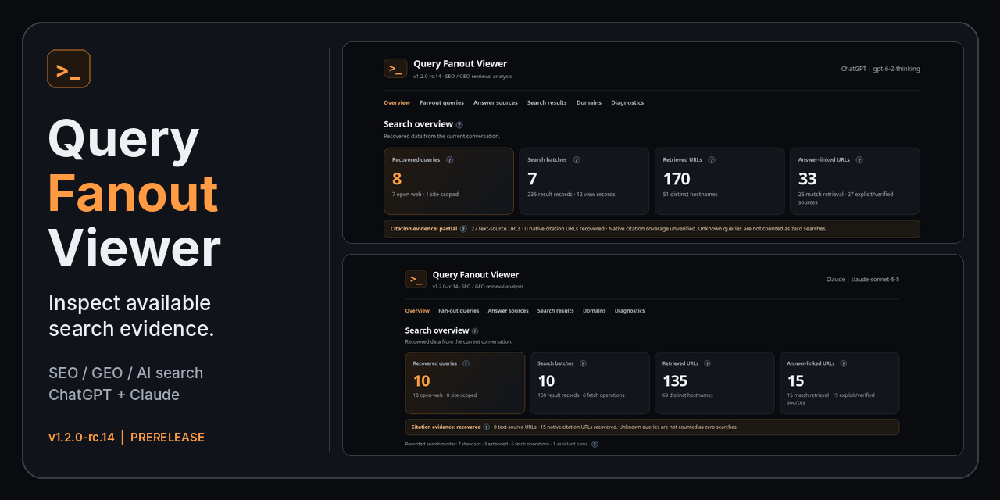
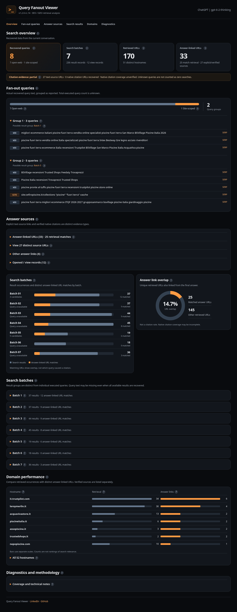
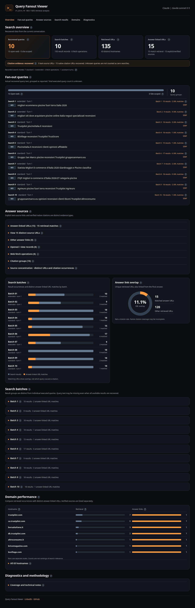

# Query Fanout Viewer

Inspect the search evidence behind AI-generated answers.

Query Fanout Viewer is a client-side JavaScript bookmarklet for SEO, GEO, AI search, information retrieval and citation analysis. It displays the search queries, retrieval batches, results, opened sources and answer evidence available in supported ChatGPT and Claude conversations, directly in your browser.

**Current prerelease: `v1.2.0-rc.14`.** Coverage varies with the provider, conversation format and model. This is not a complete trace of every search, and it does not expose private model reasoning.

[Download the prerelease bookmarklet](https://github.com/LorenzoSchiff/query-fanout-viewer/releases/tag/v1.2.0-rc.14) | [Installation](docs/INSTALLATION.md) | [Changelog](CHANGELOG.md) | [Privacy](docs/PRIVACY.md)



## Why use it?

AI-generated answers do not always make their retrieval process easy to inspect. Query Fanout Viewer helps you investigate which queries were recorded, whether retrieval was open-web or domain-scoped, which documents were returned or opened, and which URLs appeared in citations or other answer-source evidence.

Use it to compare retrieval patterns, evaluate brand and competitor visibility, inspect domain concentration, audit source selection and diagnose differences between prompts or providers. The viewer describes available evidence, not the model's internal ranking, intent or reasoning.

## What's new in v1.2

- Redesigned responsive dashboard with an overview, query groups, answer sources, retrieval batches, hostname concentration and diagnostics.
- Improved ChatGPT parsing for multiple conversation formats, `web.run` commands and query metadata, result-only batches and open/view records.
- Structured Claude web search and web fetch analysis, including multi-URL citation groups and explicit tool-operation associations where available.
- Separate handling of verified citation evidence, ordinary answer links and visible provider source panels.
- Explicit coverage indicators and `N/A` when retrieval or citation metrics cannot be established.
- Claude fallback for available visible answer evidence and explicitly labelled visible search activity, kept separate from verified structured batches.
- HTML and JSON report exports, clipboard actions and internal navigation.
- RC14: help tooltips follow the pointer in the live dashboard, stay within the viewport and support keyboard focus. Static HTML exports use native browser hover tooltips, with CSS-based keyboard help on supporting browsers.

## Screenshots

The examples below are real report data from the same ecommerce research topic, captured on November 25, 2026. The supplied RC13 HTML reports were rendered with the RC14 tooltip styling and version label for these screenshots; the retrieval records and counts are unchanged. They demonstrate the report layout and observed evidence, not complete provider coverage or a new live RC14 retrieval test.

### ChatGPT | GPT-6.2 Thinking

8 recovered queries (7 open-web, 1 site-scoped), 7 search batches, 236 result records, 170 distinct retrieved URLs and 33 answer-linked URLs. The sample contains 27 explicit text-source URLs; native citation coverage is unverified. Query-to-batch sequence candidates are not confirmed associations.



### Claude | Sonnet 5.5

10 recovered queries, 10 search batches, 150 result records, 135 distinct retrieved URLs, 15 native citation URLs and 6 fetch operations. This is a supported structured sample, not evidence of universal Sonnet or Opus compatibility.



## Compatibility

The following matrix describes observed validation, not a guarantee of future compatibility or complete retrieval. Model labels alone do not determine coverage.

| Provider / model | Observed coverage |
| --- | --- |
| ChatGPT GPT-6 / GPT-6.2, Instant and Thinking | Tested in web conversation samples. Query, batch, result and citation availability varies. |
| Claude Haiku 5.5 | Structured retrieval and citations verified in the available sample. |
| Claude Sonnet 5 | Structured retrieval recovered in one sample; coverage may vary with format. |
| Claude Sonnet 5.5 | Structured retrieval verified in JSON samples; other web-search and reload samples yielded no structured retrieval. |
| Claude Opus 5 / 5.5 | Limited to available evidence. Structured fan-out queries and batches have not been validated. |
| Claude Research | Structured retrieval not validated. |
| Claude Fable / Opus 4.x | Not tested in this validation campaign. |
| Claude Code CLI | Not supported. |
| Gemini / Google AI Mode | Not implemented. |

Claude private/incognito browsing has historically been unreliable and has not been revalidated with this prerelease. Use a normal logged-in browser session where possible.

### Important Claude limitations

Supported structured conversation JSON and documented Anthropic Messages API JSON can be inspected when the relevant search, fetch and citation records are present. Import is local and does not call the Anthropic API or require an API key.

Some consumer conversation formats do not yield recoverable structured retrieval records. This affects observed Opus samples and some Sonnet and Research samples. The viewer can display available answer links, source-panel URLs or explicitly labelled visible search activity instead. It does not decode arbitrary binary transports, infer missing queries or recover hidden sources. The RC13 visible-search-activity fallback was exercised with a synthetic fixture, not validated in a live Opus session.

Missing data does not establish that the provider performed no searches or that the data is permanently unavailable. A report marked unavailable or partial is not evidence of complete coverage.

## Installation

1. Open the [v1.2.0-rc.14 release](https://github.com/LorenzoSchiff/query-fanout-viewer/releases/tag/v1.2.0-rc.14) and download `query-fanout-viewer-v1.2.0-rc.14.txt` from Assets.
2. Open the file in a plain-text editor and copy its entire contents, including the `javascript:` prefix.
3. Create or edit a browser bookmark named `Query Fanout Viewer`; paste the copied value into its URL field.
4. Open a supported ChatGPT or Claude conversation in a normal logged-in browser session. Wait for the answer to finish.
5. Click the bookmark. Allow the report pop-up if your browser blocks it.

The release TXT is the ready-to-paste distribution asset. `src/bookmarklet.js` is the readable source, not the encoded bookmark URL. Existing users must replace their saved bookmark URL to upgrade; the bookmarklet does not update itself. See [detailed instructions](docs/INSTALLATION.md).

## Reading the dashboard

| Evidence | Meaning |
| --- | --- |
| Fan-out query | Explicitly recovered search text, not a query guessed from an answer. |
| Query group | Queries reported together in available metadata or a tool call. |
| Retrieval batch | A recovered result grouping or structured search operation. Some batches have no attributable query text. |
| Result records | Returned entries; repeated URLs can occur in different records. |
| Unique retrieval URLs | Distinct URLs after the parser's normalization rules. |
| Open/view or fetch records | Separate document-access evidence, not extra search results. |
| Citation groups and URLs | Explicit citation evidence recovered from supported records; a group may reference multiple URLs. |
| Answer links / visible sources | Other available source evidence, not automatically verified citations. |
| Visible search activity | Explicit labels recovered from an eligible visible Claude search section; not a verified structured batch. |

`site:example.com/path` is treated as a domain-scoped query. A market-level operand such as `site:.it` does not identify a single hostname. Hostname concentration describes observed retrieval or source evidence, not search engine rankings or causal influence. A `www` prefix may be normalized; other subdomains remain distinct.

Explicit reference or tool-ID associations are distinguished from sequence candidates and normalized-URL matches. A shared URL does not prove that a particular query caused a citation. Counts of result records, distinct URLs, views and citation groups are not interchangeable. Check the diagnostics before comparing conversations or providers.

## Export and research workflow

The report can be saved as HTML or JSON, and selected queries, source URLs, answer-linked URLs and source hosts can be copied. JSON contains structured report data and coverage metadata; HTML is a script-free static snapshot and does not retain live toolbar actions or the live cursor-following overlay. Native hover help remains available through the browser; keyboard help is displayed near the focused marker on browsers supporting CSS anchor positioning. Use the JSON export for further analysis, not as a substitute for an original Claude conversation or Messages API JSON import.

For reliable comparisons, use similar prompts and conversation formats, record the model and viewer version, keep result-record counts separate from unique URL counts, and exclude unavailable metrics from numerical comparisons.

## Privacy and security

The bookmarklet runs in your browser and uses your existing authenticated provider session for same-origin, read-only retrieval. The project has no backend, telemetry service or API key requirement. The legacy report/import screen can request Google Fonts. Opening source links or SERP actions contacts the relevant external site. Report exports can contain sensitive queries, URLs, titles and other retrieval metadata; inspect and sanitize them before sharing.

Only run bookmarklet code you trust. See [Privacy](docs/PRIVACY.md) and [Security](SECURITY.md). Do not post session credentials, full conversation payloads or unsanitized HAR files in public issues.

## Project structure

```text
src/bookmarklet.js       Readable bookmarklet source
docs/INSTALLATION.md     Setup, usage and troubleshooting
docs/PRIVACY.md          Data handling and privacy guidance
assets/social-preview.png          Project preview
assets/screenshots/               Report screenshots
CHANGELOG.md             Release history
```

The ready-to-copy encoded bookmarklet is distributed as a versioned GitHub release asset.

## Status and roadmap

This release is a prerelease. Provider interfaces and payload formats can change without notice. Further work may improve Claude coverage when new evidence becomes available, validate more provider formats, improve distribution and explore Gemini and Google AI Mode. No delivery date or universal model support is promised.

## Contributing and support

Reproducible bug reports, sanitized examples and provider-specific improvements are welcome. See [CONTRIBUTING.md](CONTRIBUTING.md), [SUPPORT.md](SUPPORT.md) and [SECURITY.md](SECURITY.md). Please include the viewer version, provider, model label, browser and coverage status when reporting compatibility issues.

## Author and license

Built and maintained by Lorenzo Schiff.

- [LinkedIn](https://www.linkedin.com/in/lorenzo-schiff/)
- [GitHub](https://github.com/LorenzoSchiff)

MIT. See [LICENSE](LICENSE). This independent project is not affiliated with OpenAI, Anthropic or Google.
